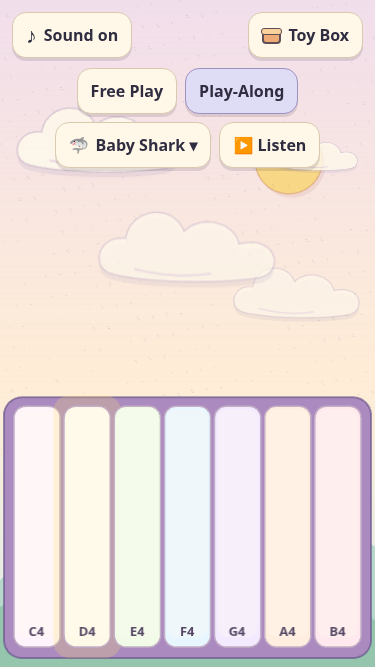

# Tingle

A tiny, whimsical collection of on-screen toys for small hands.

**Live:** [pedrodiogo.com/Tingle](https://pedrodiogo.com/Tingle/)



## What it does

Tingle is a set of gentle, tap-anywhere "toys" designed for toddlers and young kids. Checkpoints change the scene or the way you play. Every toy keeps going, and you can open the finale when you are ready. There are no ads or leaderboards. Everything runs in the browser and installs as a PWA for offline play on a tablet or phone.

Toys currently included:

- **🫧 Bubbles** — colourful bubbles drift across a pastel sky. Tap one for a chime, or hold an empty patch of sky and release to send your own bubble floating. Swipe to pop a trail of bubbles. Three gold stars start a Bubble Party and change the sky.
- **🎹 Piano** — seven large keys on narrow screens and a two-octave keyboard (C4–B5) on wider ones. The Tingle Band dances to each note. It has two modes:
  - **Free Play** — each key plays its true pitch. Start the backing beat to jam with the band.
  - **Play-Along** — pick a nursery song (Twinkle Twinkle, Baby Shark, Row Your Boat, Mary Had a Little Lamb, Old MacDonald, Itsy Bitsy Spider) and every key tap plays the next note of the melody. Kids feel the satisfaction of "playing" a real song without having to hit the right keys. A "Listen" button plays the whole melody with proper tempo so they can learn the tune first. Keep tapping after a song to start the next one in the setlist.

- **🐶 Puppy Plane** — a toon-shaded 3D side-scroller. Touch or drag to fly. Collect letters from balloons and fly to the cloud mailbox to deliver them. Every pair of deliveries opens a different route with drifting mailboxes. Switch on the obstacle course for three faster waves.

- **Sky Circus** — a 3D WebGL toy. Drag or use the arrow keys to fly, tap balloons to pop them, and hit Barrel roll (Space) for a boost. Fly through three hoops to change the sky and learn a new hoop pattern. Pop five balloons to catch a tailwind. Watch the puppy turn back toward you after special moments.

- **Critter Bounce** — slide the spring or tap Bounce to send a bunny up toward the stars. Tap a star to guide the next jump. Three stars change the meadow, moving the stars and changing how the bunny jumps.
- **Cloud Kitchen** — tap or drag toppings onto a cloud sundae, follow a picture order or invent your own, then serve it for a comic surprise. The specials stack four toppings.

- **Unicorn Trails** — draw a rainbow route, collect lost stars, and send a unicorn to deliver them. Six boards introduce lantern bridges and mushroom shortcuts. Continue to mirrored boards after the star parade.

Visit all four bubble worlds or meadows, play three songs, deliver eight letters, fly through fifteen hoops, or match eight recipes to unlock **Finale**. Puppy Plane’s obstacle course has its own three-wave finale. All activities keep going after the finale unlocks.

Open the Toy Box to switch toys. Tingle remembers your last toy and sound setting.

## Who it's for

Very young children (roughly 1–5 years old) and the adults playing alongside them. The design goals:

- **Safe to hand over** — no menus to accidentally exit into, no network requests after first load, no ads, no in-app purchases, no tracking.
- **Forgiving input** — large hit targets, no "wrong" interactions, every touch produces a pleasing reaction.
- **Musical consonance** — bubble pitches and piano play-along mean a child mashing the screen produces something that sounds like music, not noise.
- **Calm** — soft pastel art, ambient pad on Bubbles, gentle animations. Nothing flashes or demands attention.

## Running locally

```bash
npm install
npm run dev
```

Open the local URL Vite prints.

## Stack

TypeScript · [Pixi.js v8](https://pixijs.com/) · Vite · [vite-plugin-pwa](https://vite-pwa-org.netlify.app/). Deployed to GitHub Pages via a workflow in `.github/workflows/deploy.yml`.
